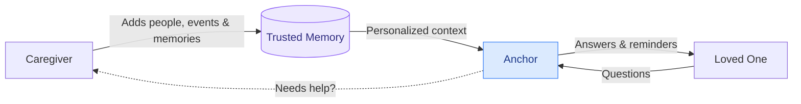
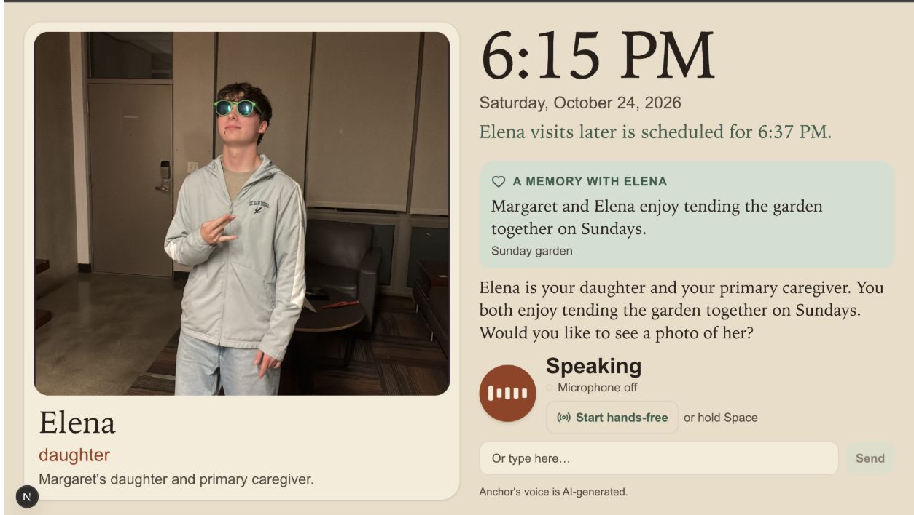
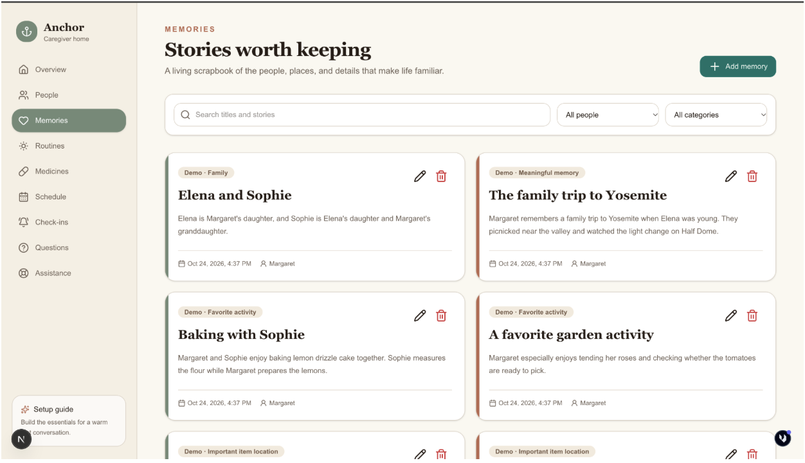
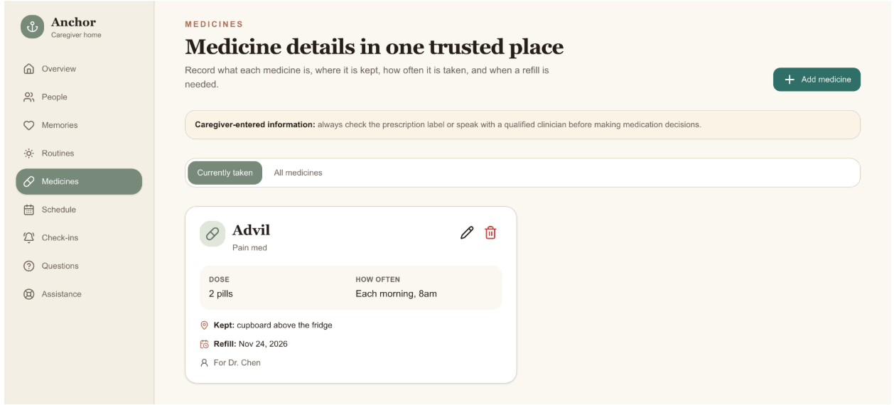
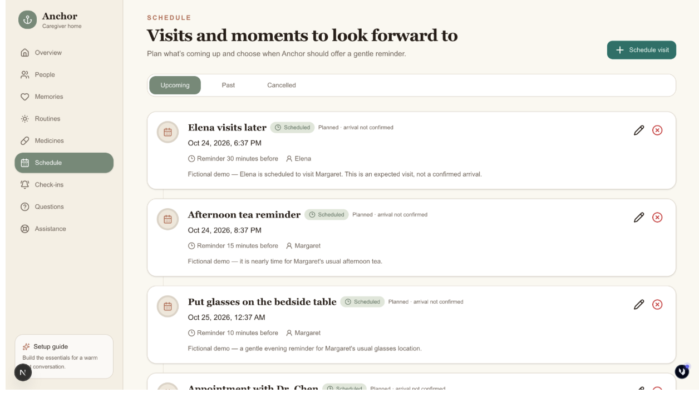
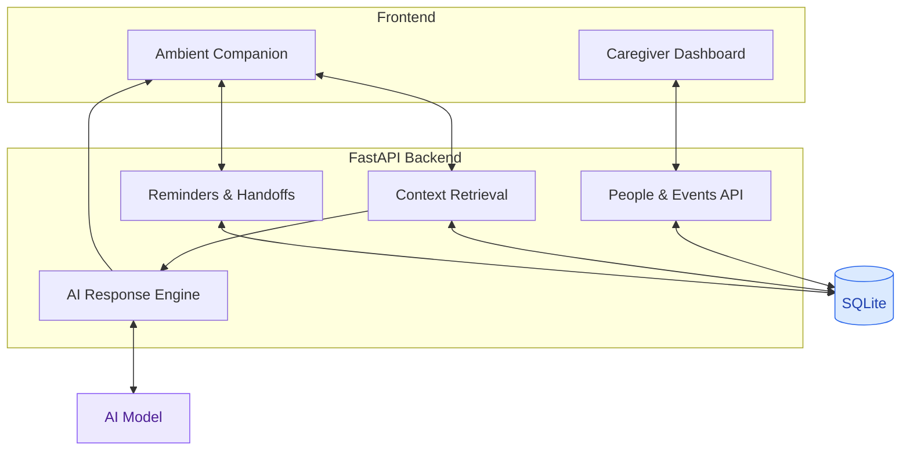
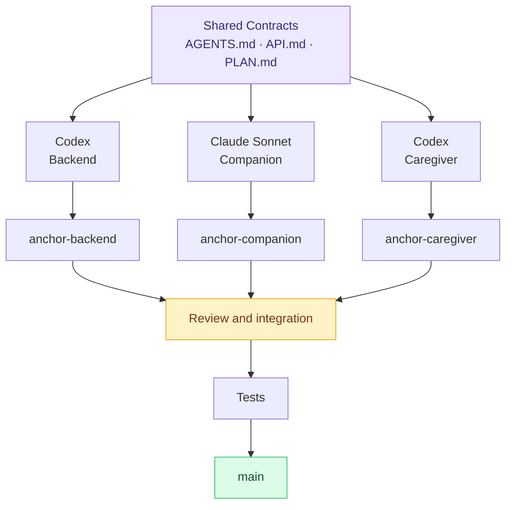
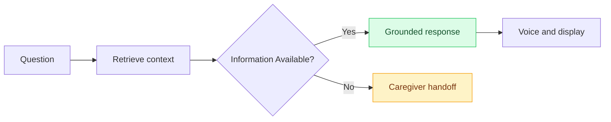

<div align="center">

# Anchor

### A memory companion that remembers with you.

**An ambient AI companion helping people with Alzheimer's and early-stage dementia stay connected to their loved ones, routines, and everyday lives.**

Built at **c0mpiled-16 · UC San Diego · October 2026**


**[Product](#the-experience) · [Architecture](#architecture) · [Development](#how-we-built-it) · [Testing](#testing) · [Setup](#getting-started)**

</div>

---

## At a Glance

**The problem:** 7.4 million Americans live with Alzheimer's. Family caregivers cannot always be in the room, and many existing tools still depend on the person remembering to open an app and navigate it.

**Our solution:** Anchor gives a person a simple, voice-first companion at home. A caregiver adds trusted details about family, memories, medicine, routines, and upcoming events through a web dashboard. Anchor can then answer everyday questions, show a familiar photo, read reminders aloud, or ask a caregiver when the answer is not in the record.

The current prototype runs in a browser, with an interface designed for a shared home display. The same interaction model could later live on a dedicated device similar to a smart speaker with a screen.

| Product | Technology | Development |
|---|---|---|
| Context-aware AI | FastAPI + SQLite | Codex + Claude |
| Ambient companion | React frontend | 3 parallel agents |
| Voice interaction | Speech APIs | Git worktrees |
| Proactive reminders | Structured data | Contract-first development |
| Caregiver dashboard | REST APIs | Human integration |

---

## The Experience

### One connected experience. Two perspectives.



<table>
<tr>
<td width="50%" valign="top">

### For Caregivers

Manage information remotely.

- People and relationships
- Photographs and descriptions
- Visits and appointments
- Personalized reminders
- Questions requiring assistance

</td>
<td width="50%" valign="top">

### For Loved Ones

Receive support naturally.

- Familiar faces and memories
- Large clock and daily schedule
- Voice conversations
- Proactive reminders
- Simple, reassuring answers

</td>
</tr>
</table>

### Product Screens

#### Companion display

The companion keeps the current time, a familiar person, relevant memories, and the conversation in one large, readable view. Voice and typed input use the same grounded conversation flow.



#### Caregiver dashboard

Caregivers can update the information Anchor is allowed to use. Changes are stored in SQLite and become available to the companion through the backend API.

| Memories | Medication details |
|---|---|
|  |  |



### See Anchor in Action

<details open>
<summary><b>Who's visiting today?</b></summary>

<br>

**You:** "Who's coming over today?"

**Anchor:** "Your daughter Elena is scheduled to visit at 6:37 PM. I can show you her picture."

*Elena's photograph appears on the companion display.*

Anchor describes this as a scheduled visit. It does not claim Elena has arrived unless that information is actually available.

</details>

<details>
<summary><b> What's happening today?</b></summary>

<br>

**You:** "What do I have planned today?"

**Anchor:** "You have a doctor's appointment at 11 AM, and Elena is scheduled to visit this afternoon."

*Information is retrieved from the caregiver-managed schedule.*

</details>

<details>
<summary><b> What if Anchor doesn't know?</b></summary>

<br>

**You:** "Is Michael coming tomorrow?"

**Anchor:** "I'm not sure yet. I can ask your caregiver."

The question enters the caregiver handoff workflow rather than receiving an invented answer.

</details>

---

## Architecture

### How everything connects



The caregiver record is the source of truth for personal details. Before answering a personal question, the backend retrieves the relevant people, memories, medication records, events, and handoffs. If the record does not support an answer, Anchor says that it does not know and offers a caregiver handoff instead of filling in the gap.

**Stack:** React · FastAPI · Python · SQLite · LLM APIs · Speech-to-Text · Text-to-Speech

---

## How We Built It

We split the work into three clear areas: backend, companion, and caregiver dashboard. Each area had its own branch and Git worktree, so work could happen in parallel without sharing an unfinished checkout.

### Why we planned before coding

We had five hours to build the demo, and the available AI-agent credits were limited. Spending part of that time planning felt expensive at first, but it prevented much more expensive rework later. Before any branch started, we agreed on the minimum demo, the API contract, file ownership, merge order, and the checks required for a handoff.

That early planning mattered for two practical reasons:

1. Coding agents can easily spend time on extra abstractions, duplicate work, or features that do not fit together. A narrow plan kept each agent focused on the smallest reliable end-to-end experience and made clear what we were intentionally not building.
2. Every correction and repeated prompt used more of a limited credit budget. Giving each agent the same contracts and acceptance criteria reduced back-and-forth and saved those credits for integration, testing, and the parts users would actually see.

The plan was not meant to predict every detail. It gave us enough shared structure to move quickly, then left room to adjust when the three branches met in `main`.

### Three worktrees, one codebase



| Agent | Ownership | Tools |
|---|---|---|
| **Backend** | APIs, database, grounded responses | Codex |
| **Companion** | Ambient UI, voice, reminders | Claude Sonnet |
| **Caregiver** | Dashboard, forms, handoffs | Codex |
| **Integration** | Architecture, merges, testing | Human team |

### Why Git worktrees?

Each agent worked in an isolated checkout and branch, allowing simultaneous development without overwriting another agent's files.

```text
anchor/                 ← Main integration
├── anchor-backend/     ← Codex
├── anchor-companion/   ← Claude
└── anchor-caregiver/   ← Codex
```

**Our workflow:**

`Specify → Delegate → Build in Parallel → Review → Merge Sequentially → Test`

<details>
<summary><b>How the development process worked</b></summary>

<br>

**1. Contract-first development**

We defined responsibilities, API interfaces, and implementation priorities in `AGENTS.md`, `API.md`, and `PLAN.md`.

**2. Parallel implementation**

Each agent developed its assigned subsystem in a separate Git worktree.

**3. Independent verification**

Each branch was checked in its own worktree before it was handed back for integration.

**4. Sequential integration**

Changes were reviewed and merged one component at a time.

**5. Human validation**

We walked through the real caregiver and companion flows, resolved conflicts by file ownership, and kept the demo focused on interactions we could verify.

The branches were developed in parallel but merged one at a time: shared work, backend, companion, caregiver, then integration fixes.

</details>

---

## Technical Highlights

| System | Implementation |
|---|---|
| **Personal memory** | Structured people, relationships, and events in SQLite |
| **Grounded AI** | Retrieves caregiver-provided context before generating responses |
| **Ambient UI** | Persistent clock, photographs, and upcoming events |
| **Voice** | Speech recognition and spoken responses |
| **Proactive reminders** | Time-based event awareness and reminder announcements |
| **Caregiver handoffs** | Escalation path for missing information |
| **Verification** | pytest, companion logic tests, Playwright browser checks, linting, type checks, and production builds |
| **Parallel development** | Independent Git worktrees with shared API contracts |

### The response pipeline



---

## Testing

We tested the project at several levels:

- **Backend API and safety behavior:** pytest covers CRUD operations, validation, SQLite persistence, grounded conversation routing, medication boundaries, reminders, handoffs, and caregiver communication state changes.
- **Companion behavior:** Node tests cover voice output and fallback behavior, interruption, reminder queues, acknowledgement state, daily check-ins, and context selection.
- **Frontend checks:** ESLint, TypeScript, and the Next.js production build catch code, type, and bundling problems.
- **Browser flows:** We used Playwright-driven Chromium sessions during integration to exercise the caregiver dashboard and companion together, including photo display, typed input, reminders, navigation, and calls to the local backend. These were integration smoke checks rather than a committed Playwright test suite.
- **OpenAI integration:** opt-in live tests verify grounded response generation and caregiver action planning when credentials are available. Text-to-speech was also checked against the real endpoint, with browser speech kept as a fallback.

```bash
cd backend
uv run ruff check .
uv run pytest

cd ../frontend
npm run lint
npx tsc --noEmit
npm run build
node --test src/components/companion/logic/__tests__/*.test.mjs
```

---

## Getting Started

```bash
git clone https://github.com/VincentSchelstraete1/Anchor-compiled-hackathon.git
cd Anchor-compiled-hackathon
```

### Backend

```bash
cd backend
cp .env.example .env
uv sync
uv run uvicorn app.main:app --reload --host 127.0.0.1 --port 8000
```

Add `OPENAI_API_KEY` to `backend/.env` to enable OpenAI conversation and text-to-speech calls. Without it, the backend still runs and the companion can fall back to browser speech.

Check the API at [http://localhost:8000/health](http://localhost:8000/health) or open [http://localhost:8000/docs](http://localhost:8000/docs).

### Frontend

```bash
cd frontend
cp .env.example .env.local
npm install
npm run dev
```

Open [http://localhost:3000](http://localhost:3000). The frontend reads `NEXT_PUBLIC_API_URL` and defaults to `http://localhost:8000`.

---

## Team

| Name | Profile |
|---|---|
| Vincent Schelstraete | [LinkedIn](https://www.linkedin.com/in/vincentschelstraete) |
| Aayush Bhambi | [LinkedIn](https://www.linkedin.com/in/aayush-b-928972280/) |
| Edwin Juarez | [LinkedIn](https://www.linkedin.com/in/edwin-julien-juarez-b678a6284/?isSelfProfile=false) |

Project repository: [VincentSchelstraete1/Compiled-hackathon](https://github.com/VincentSchelstraete1/Compiled-hackathon)

---

## Why It Matters

Anchor is meant to make common questions easier to answer without turning every moment into a phone call or another app to navigate. It gives caregivers one place to keep information current and gives their loved one a calmer way to reach it.

**Anchor supplements human caregiving. It does not replace it.**

### What we would build next

`Wake-word activation` · `Family voice recordings` · `Offline support` · `Shared caregiver accounts` · `Richer personal memories`

---

<div align="center">

Built at **c0mpiled-16**, UC San Diego — October 24, 2026.

</div>
