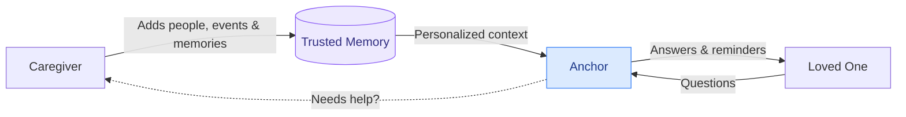
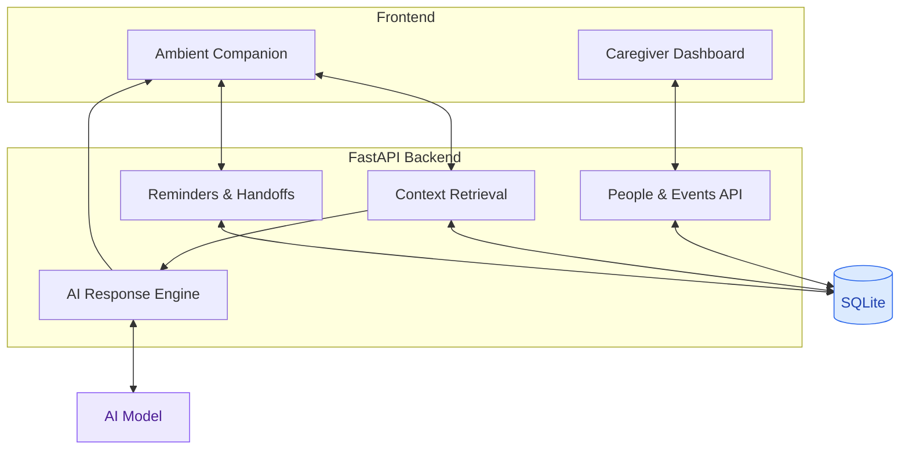
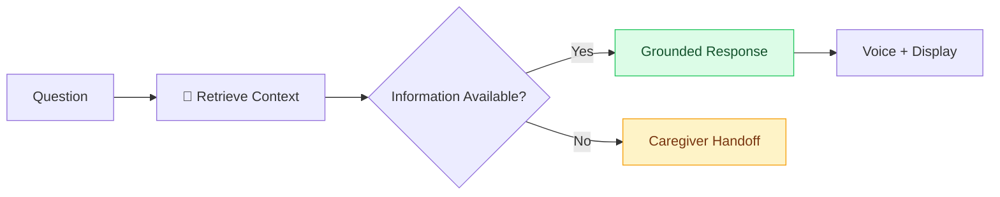

<div align="center">

#  Anchor

### A memory companion that remembers with you.

**An ambient AI companion helping people with Alzheimer's and early-stage dementia stay connected to their loved ones, routines, and everyday lives.**

Built at **c0mpiled-16 · UC San Diego · October 2026**


**[Features](#-the-experience) · [Architecture](#-architecture) · [AI Engineering](#-built-with-ai-agents) · [Setup](#-getting-started)**

</div>

---

## At a Glance

**The problem:** 7.4 million Americans live with Alzheimer's, while millions of family caregivers struggle to provide constant support. Existing tools often require users to remember to open an app or ask for help.

**Our solution:** Anchor is a hands-free voice activated always-available companion that remembers important people, explains upcoming events, answers questions, and proactively provides reminders. Only need to be set up once through our online portal, Anchor is intended to work through a home-pod similar to Alexa, and contains functionality as a website through existing technology like on a computer.

**How we built it:** We orchestrated three specialized AI coding agents—Codex and Claude Sonnet—working simultaneously in isolated Git worktrees, coordinated through shared API contracts and human-reviewed integration.

| Product | Technology | Development |
|---|---|---|
| Context-aware AI | FastAPI + SQLite | Codex + Claude |
| Ambient companion | React frontend | 3 parallel agents |
| Voice interaction | Speech APIs | Git worktrees |
| Proactive reminders | Structured data | Contract-first development |
| Caregiver dashboard | REST APIs | Human integration |

---

## The Experience

### One connected experience. Two perspectives.



<table>
<tr>
<td width="50%" valign="top">

### For Caregivers

Manage information remotely.

- People and relationships
- Photographs and descriptions
- Visits and appointments
- Personalized reminders
- Questions requiring assistance

</td>
<td width="50%" valign="top">

### For Loved Ones

Receive support naturally.

- Familiar faces and memories
- Large clock and daily schedule
- Voice conversations
- Proactive reminders
- Simple, reassuring answers

</td>
</tr>
</table>

### See Anchor in Action

<details open>
<summary><b>Who's visiting today?</b></summary>

<br>

**You:** "Who's coming over today?"

**Anchor:** "Your daughter Sarah is visiting at 3 PM! Here's a picture of her."

*Sarah's photograph appears on the companion display.*

**At 2:30 PM:** "Sarah will be here in about 30 minutes!"

</details>

<details>
<summary><b> What's happening today?</b></summary>

<br>

**You:** "What do I have planned today?"

**Anchor:** "You have a doctor's appointment at 11 AM, and Sarah is visiting this afternoon."

*Information is retrieved from the caregiver-managed schedule.*

</details>

<details>
<summary><b> What if Anchor doesn't know?</b></summary>

<br>

**You:** "Is Michael coming tomorrow?"

**Anchor:** "I'm not sure yet. I can ask your caregiver."

The question enters the caregiver handoff workflow rather than receiving an invented answer.

</details>

---

##  Architecture

### How everything connects



**Core idea:** The AI doesn't have to invent someone's personal history. It retrieves relevant people, relationships, and events from structured caregiver-provided information before responding.

**Stack:** React · FastAPI · Python · SQLite · LLM APIs · Speech-to-Text · Text-to-Speech

---

## Built With AI Agents

### We didn't just build an AI product. We built it using a parallel AI engineering team.

Instead of relying on one coding agent, we divided the application into independently developed components.

### Three Agents. Three Worktrees. One Application.

```mermaid
flowchart TB
    S[“ Shared Contracts<br/>AGENTS.md · API.md · PLAN.md"]

    S --> A[" Codex<br/>Backend Engineer"]
    S --> B[" Claude Sonnet<br/>Companion Engineer"]
    S --> C[" Codex<br/>Caregiver Engineer"]

    A --> D[" anchor-backend"]
    B --> E[" anchor-companion"]
    C --> F[" anchor-caregiver"]

    D --> G[" Human Integration"]
    E --> G
    F --> G

    G --> H[" Tests + Review"]
    H --> I[" main"]

    style S fill:#ede9fe,stroke:#8b5cf6,color:#312e81
    style G fill:#fef3c7,stroke:#f59e0b,color:#78350f
    style I fill:#dcfce7,stroke:#22c55e,color:#14532d
```

| Agent | Ownership | Tools |
|---|---|---|
| **Backend** | APIs, database, grounded responses | Codex |
| **Companion** | Ambient UI, voice, reminders | Claude Sonnet |
| **Caregiver** | Dashboard, forms, handoffs | Codex |
| **Integration** | Architecture, merges, testing | Human team |

### ⚡ Why Git Worktrees?

Each agent worked in an isolated checkout and branch, allowing simultaneous development without overwriting another agent's files.

```text
anchor/                 ← Main integration
├── anchor-backend/     ← Codex
├── anchor-companion/   ← Claude
└── anchor-caregiver/   ← Codex
```

**Our workflow:**

`Specify → Delegate → Build in Parallel → Review → Merge Sequentially → Test`

<details>
<summary><b>🔍 Explore our AI engineering process</b></summary>

<br>

**1. Contract-first development**

We defined responsibilities, API interfaces, and implementation priorities in `AGENTS.md`, `API.md`, and `PLAN.md`.

**2. Parallel implementation**

Each agent developed its assigned subsystem in a separate Git worktree.

**3. Independent verification**

Backend tests, frontend builds, and browser testing helped identify issues before integration.

**4. Sequential integration**

Changes were reviewed and merged one component at a time.

**5. Human validation**

Our team tested real interactions, resolved integration issues, and prioritized the final experience.

**Key principle:** Agents work in parallel. Integration happens sequentially.

</details>

 **Learn more:** [Git Worktrees Documentation](https://git-scm.com/docs/git-worktree?utm_source=chatgpt.com) · [OpenAI Codex](https://openai.com/codex/?utm_source=chatgpt.com) · [Claude](https://claude.ai/?utm_source=chatgpt.com)

---

##  Technical Highlights

| System | Implementation |
|---|---|
| **Personal memory** | Structured people, relationships, and events in SQLite |
| **Grounded AI** | Retrieves caregiver-provided context before generating responses |
| **Ambient UI** | Persistent clock, photographs, and upcoming events |
| **Voice** | Speech recognition and spoken responses |
| **Proactive reminders** | Time-based event awareness and reminder announcements |
| **Caregiver handoffs** | Escalation path for missing information |
| **Verification** | pytest, Playwright, frontend builds, and manual testing |
| **Parallel development** | Independent Git worktrees with shared API contracts |

### The response pipeline



---

##  Getting Started

```bash
# Clone the project
git clone <REPOSITORY_URL>
cd anchor
```

Configure the backend environment, install the Python and frontend dependencies, and start the application using the scripts included in the repository.

*Exact installation and startup commands will be added after final integration.*

---

##  Why It Matters

Anchor explores how ambient AI can make everyday technology more accessible for people experiencing cognitive decline.

Our goal is to help people maintain independence, reduce repetitive coordination for caregivers, and keep loved ones connected.

**Anchor supplements human caregiving. It does not replace it.**

### What's Next?

`Wake-word activation` · `Family voice recordings` · `Offline support` · `Shared caregiver accounts` · `Richer personal memories`

---

<div align="center">

###  Built at c0mpiled-16

**UC San Diego · October 24, 2026**

*No App*

[Hackathon Event](https://luma.com/compiled-im3b?utm_source=chatgpt.com) · [Community Discord](https://discord.gg/R59XBUBN6?utm_source=chatgpt.com)

---

### Anchor

**A little more independence. A little more connection. Every day.**

*Built by humans and AI agents, for the people who matter most.*

</div>
